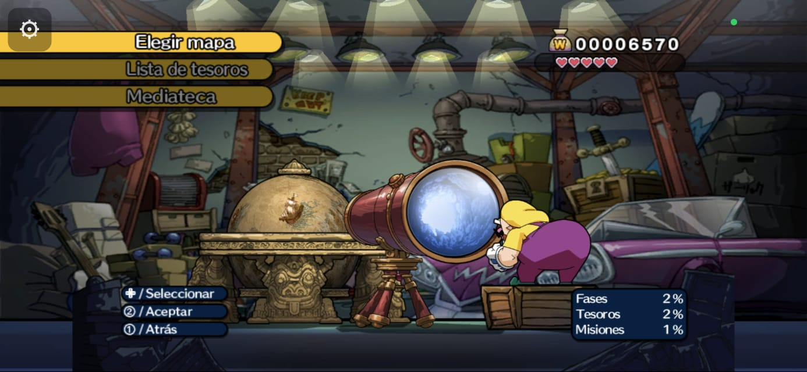
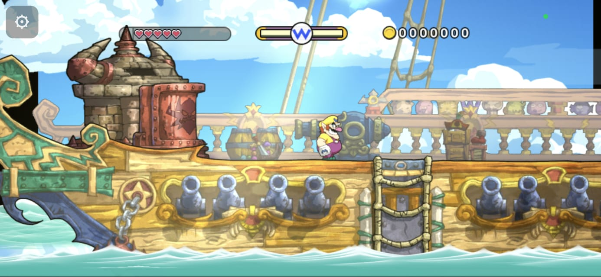
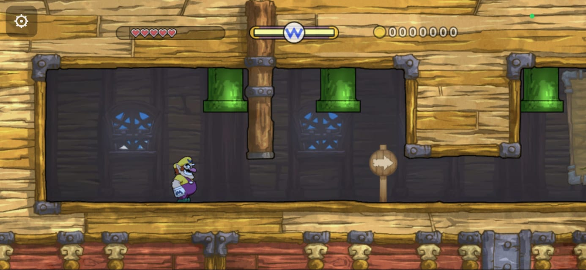
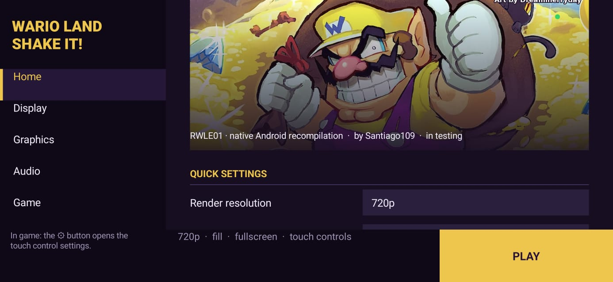

# WarioRecomp — Wario Land: Shake It! for PC now for Android

> ⚠️ **Testing build.** The game boots, saves and is playable, but parts of it are still untested: expect
> graphical glitches, crashes or features that don't respond yet. If you find one, please open an *issue* and
> attach the log (`storage/emulated/0/Android/data/com.wario.shakeit/files/Logs`), or the launcher's **Log** page).

**WarioRecomp** is an unofficial native PC port of *Wario Land: Shake It!* (Wii, 2008, US release `RWLE01`),
by **Santiago109**. The game's PowerPC code is **statically recompiled** to C++ with
[WiiCompiled](https://github.com/patchzyy/Wiicompiled) and runs as a regular Windows program, **not in an
emulator**: the Wii system libraries (video, audio, controllers, disc, saves) are replaced with native code.

This fork adds android support with full editable touch controls, ultrawide without stretching, 
and rotate the phone as if it were a Wii Remote for certain game functions.

<p align="center">
  
  
  
</p>
<p align="center">
  
</p>

## Features

- **Render resolution** from the original 480p up to 720p, 1080p and 1440p.
- **Aspect ratio:** true 16:9 widescreen (the game itself draws wider), fill the window, cinematic 2.39:1, or
  the original 4:3.
- **Windowed, borderless or exclusive fullscreen** (F11 switches in game), VSync and an FPS counter.
- **Experimental frame interpolation** to 120 FPS.
- **Gamepad and keyboard** with full remapping: Xbox, PlayStation (DualSense / DualShock 4), Nintendo Pro
  Controller and Android handheld (tested with DualShock 4)
- **Wii Remote motion:** You can rotate the phone or use the shake and the yellow circle buttons on the screen, with a
- controller you can remap the buttons for doing that
- **Skippable intro** with one button (the skip button on screen).
- **Launcher** with display, graphics, audio, game and controls settings, disc import, save backups, the game
  log and one-click install.
- **Automatic save backups** before every start (the last 10 are kept).
- Game language (English, Spanish, French) and launcher language (English, Spanish).

## Game data

This repository and its downloads **contain nothing from the game**: no game executable, no game data and no
translated code. You need **your own copy** of *Wario Land: Shake It!* (US, `RWLE01`, unmodified). The
launcher reads it, checks that it is the right one (`main.dol` with SHA-256 `053BE60D…912A`) and **builds the
port on your PC**, the same way the WiiCompiled installer does.

## How to play

**Requirements**

- 64-bit Windows 10 or 11.
- A graphics card with Direct3D 12 or Vulkan.
- About 3 GB of free space for the build, plus 4.4 GB if the launcher extracts your disc image.
- 16 GB of RAM or more recommended while building.
- Your disc as `.iso`, `.wbfs`, `.ciso` or `.rvz` (or already extracted to a folder with `sys\` and `files\`).

The download (~250 MB) already includes the compiler and every build tool, so installing needs no internet.

**Steps** (once on the phone)

1. Download the latest release (`WarioRecomp.apk-<version>-`) and install it.
2. Open the app.
3. press **Install**, then pick your extracted game copy in a zip (the DATA folder)
4. Wait while it extracts the game, when it finishes the app starts the game automatically

## Controls

| Action (sideways Wii Remote) | Keyboard | DualSense / PlayStation |
|---|---|---|
| Move | Arrow keys | D-pad |
| Jump (2 button) | X / Space | ✕ |
| Run / attack (1 button) | Z / Left Shift | ○ / □ |
| A button | A | △ |
| Shake | C / Left Ctrl | L2 / R2 |
| Tilt left / right | Q / E | L1 / R1 |
| Tilt / aim with the stick | — | Left stick |
| + (pause) | Enter / Esc | Options |
| − | - / Tab | Create |
| Motion sensors off / on | — | Touchpad click |
| Skip the intro | Enter / Space / X | ✕ / ○ / Options |

Xbox and Nintendo controllers use the same button positions. Everything can be remapped on the launcher's **Controls** page.

## The launcher

| Page | What's there |
|---|---|
| Home | Quick settings, game status and the PLAY button |
| Display | Aspect ratio, VSync, FPS counter |
| Graphics | Render resolution, frame interpolation, textures (not tested) |
| Audio | Master volume, mute, audio mixing thread |
| Game | Data import, game language, save backups |
| Controls | Gamepad mapping per action, rumble |
| Advanced | Launcher language, credits |
| Install | Import the game data in a zip |
| Log | The latest game log, ready to paste into an *issue* |

The language button at the bottom of
the left menu switches English / Spanish at any time. Settings are stored in `Play\UserData\Config.toml` (the
in-game F10 menu changes the same values). The header image and the icon live in `local-assets\`
(`launcher_banner.jpg`, `wario.ico`); both use fan art by **Dreaminerryday**. To use your own header,
put a `launcher_banner.jpg` or `.png` in `Play\UserData\`.

## Saves

Saves are in `Play\UserData\NAND\title\00010000\52574c45\data` (`WLS.bin` and `banner.bin`), or in the folder
you choose on the **Game** page. Before every start the launcher copies them to `Play\UserData\SaveBackups`, and
**Game → Restore** goes back to an earlier copy.

## Updating

The launcher checks for a new version when it starts (and on **Install → Check for updates**). It downloads
only the code from this repository, never any game data, and then rebuilds on your PC: a quick rebuild
(minutes) when the change only touches the runtime, or a full one (15 to 45 minutes) when the translation
changed. Your imported game, saves and settings are kept (they are all in `Play\UserData`).

You can also unzip a new release over the old folder and rebuild from **Install**.

For maintainers: bump `version` in `version.json`, and set `quick_from` to the oldest version that can
still use a quick rebuild (set it to the new version when the translation changes).

## Building from source

The launcher does all of this for you; by hand it is:

```
Build-WarioRecomp.cmd         downloads missing tools, translates the game, builds it and runs a 60 s test
Quick-Rebuild.cmd             rebuilds without translating or downloading again
Build-Launcher.cmd            builds the launcher (.NET Framework 4.8)
Make-Release.cmd              makes dist\WarioRecomp-<version>.zip (with nothing from the game)
```

The first time, point the build at your game: import it in the launcher, or run
`tools\build-wario.ps1 -GameData D:\path\to\DATA` (the folder with `sys\main.dol`).

| Folder | Contents |
|---|---|
| `fw/` | The parts of WiiCompiled the build uses: the C# translator and the dependency scripts |
| `projects/wario/` | Translation setup: `recomp.yml`, the function map and the verified Wario addresses |
| `runtime/` | The runtime adapted to Wario (adapted from WiiCompiled's runtime) |
| `aurora/` | Aurora, the Wii GX graphics layer (adapted from WiiCompiled's copy) |
| `tools/` | Build scripts (port, launcher, release package) |
| `launcher/` | The launcher (C# WinForms) |
| `local-assets/` | Launcher icon and header image (fan art by Dreaminerryday) |
| `screenshots/` | The images in this README |

## Status

Working: boot, intro (and skipping it), menus, saves (create, load, save), the world map, the levels tested so
far, audio, ultrawide, gamepad. Still to test or to do:

- Playing through the whole game (bosses, every level and the 12 story movies).
- The DualSense accelerometer, and shaking everywhere the game asks for it.
- Performance with many enemies on screen.
- Separate music, sound effects and voice volumes.
- An HD texture pack.

## Credits

- **Santiago109** — the port.
- **Dreaminerryday** — the Wario fan art used for the launcher header and the icon.
- **[WiiCompiled](https://github.com/patchzyy/Wiicompiled)** — patchzyy and contributors: recompiler and runtime (GPL-3.0).
- **Aurora** — Luke Street: Wii GX graphics on WebGPU (MIT). Dawn, SDL3 and the other components are listed in
  [`fw/THIRD-PARTY-NOTICES.md`](fw/THIRD-PARTY-NOTICES.md).
- **[nod / nodtool](https://github.com/encounter/nod)** — Luke Street: Wii disc image reading (MIT).
- **[Dolphin Emulator](https://dolphin-emu.org)** — Wii SDK function signature database (GPL-2.0+).
- **[llvm-mingw](https://github.com/mstorsjo/llvm-mingw)**, **CMake**, **Ninja** and **.NET** — building.

## License

GPL-3.0 (see [`LICENSE`](LICENSE)), like WiiCompiled. Third-party components keep their own licenses.

## Disclaimer

This is an **unofficial** fan project. It is not affiliated with, or endorsed by, Nintendo or Good-Feel. It
contains no game code or data: you need your own legal copy. *Wario Land: Shake It!* and Wario are trademarks of
Nintendo.
